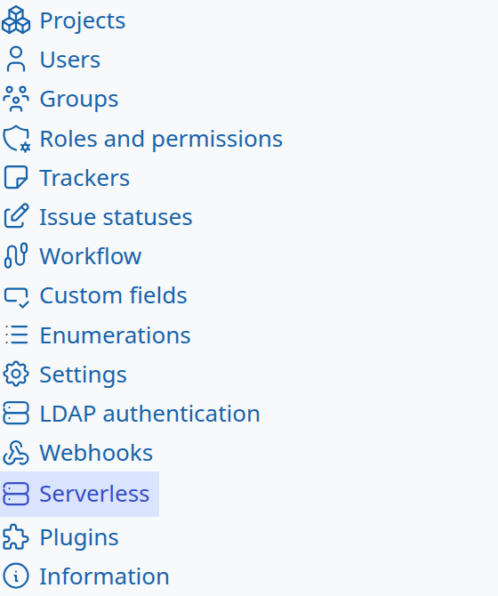
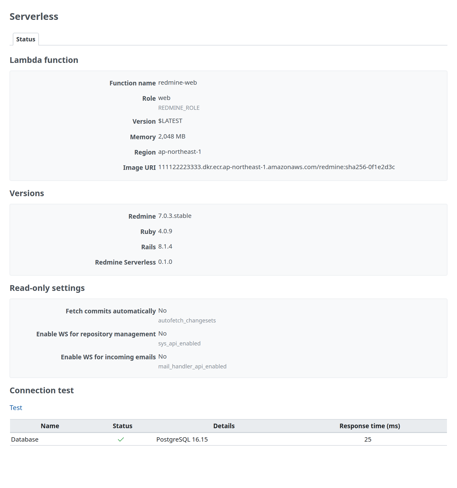
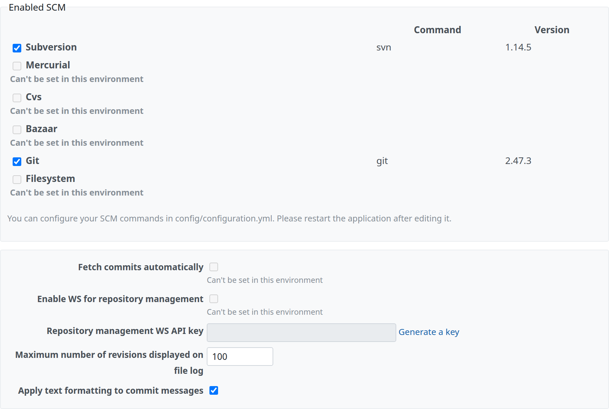

# Administration pages

This page describes the "Serverless" item of Redmine's administration menu, which every Redmine Serverless plugin shares, and of the page that Redmine Serverless puts there. Pages for features that are not in use are not shown. The page lets you check the state of connections to AWS from within Redmine. [Redmine Serverless S3](https://redmine-kit.github.io/redmine_serverless_s3/admin.html), [Redmine Serverless SES](https://redmine-kit.github.io/redmine_serverless_ses/admin.html) and [Redmine Serverless SQS](https://redmine-kit.github.io/redmine_serverless_sqs/admin.html) add their pages as tabs here when they are installed.

The specifications in this page were checked against official information and the Redmine 7.0.3 source as of 2026-11-08. Sources are in [sources.md](https://redmine-kit.github.io/serverless/sources.html).

## Approach

| Item | Details |
| --- | --- |
| Administrators only | Every page can be opened only by Redmine administrators. It uses the same check as Redmine's administration pages (`require_admin`) |
| No secrets shown | Values in SSM Parameter Store, `SECRET_KEY_BASE` and the database password are not shown. Only parameter names and whether they could be read are shown |
| Call AWS APIs only when needed | So that opening a page does not call many APIs, state is cached for 1 minute, and the connection check runs only when its button is pressed (one light call per service, in the request) |
| Non-secret settings are changed on the page | Non-secret settings are plugin settings (Redmine's `Setting.plugin_*`, stored in the database) and can be changed on the page. Values set by the infrastructure, such as AWS resource names, stay as environment variables and are only displayed |
| Operations are logged | Operations on the pages are written to Redmine's log with who did what and when |

## List of pages

| Page | Added by | Contents |
| --- | --- | --- |
| Status | This plugin | The running function and its version, whether the database and each AWS service are reachable, names of loaded settings, read-only Redmine settings |
| Jobs | [Redmine Serverless SQS](https://redmine-kit.github.io/redmine_serverless_sqs/admin.html) | Added by that plugin when it is installed |
| Email sending, Email receiving | [Redmine Serverless SES](https://redmine-kit.github.io/redmine_serverless_ses/admin.html) | Added by that plugin when it is installed |
| S3 | [Redmine Serverless S3](https://redmine-kit.github.io/redmine_serverless_s3/admin.html) | Added by that plugin when it is installed |

## The Serverless menu

All the Redmine Serverless plugins put their administration pages under one item, "Serverless", in Redmine's administration menu, whichever of them are installed. The pages are tabs of one page.

| Item | Details |
| --- | --- |
| One item | The first plugin that loads adds the "Serverless" item and the shared page; the others only add their tabs. A plugin adds the item only if Redmine's administration menu does not have it yet (`Redmine::MenuManager.items(:admin_menu)`). Every plugin carries the same three files: the registry `RedmineServerlessAdmin` (`lib/redmine_serverless_admin.rb`), the controller `ServerlessAdminController` and the view `serverless_admin/_tabs`. Redmine's code loader and view paths use the first copy and ignore the others, so the copies are kept the same (`SHARED_VERSION`). Each plugin registers its tab and its connection check there in `init.rb` (`register_tab`, `register_check`); the first registration adds the menu item. The item opens `/admin/serverless`, which goes to the first tab |
| Order of the tabs | Status, Jobs, Email sending, Email receiving, S3. A tab appears only when its plugin is installed |
| Without this plugin | The "Status" tab is not shown, and the other plugins' tabs still appear under "Serverless". For example, a Redmine with only Redmine Serverless S3 has a "Serverless" item with one tab, "Attachments in S3" |
| From the plugin list | The plugins have no settings page of Redmine's plugin settings, so the plugin list shows no "Configure" link. Their settings are on their tabs |
| Project settings | The "Mail" tab in project settings that Redmine Serverless SES adds is not part of this menu |

## Status

| Item | Contents | Source |
| --- | --- | --- |
| Lambda function | Function name, role (`REDMINE_ROLE`), version, memory, Region, image URI | Lambda environment variables (`AWS_LAMBDA_FUNCTION_NAME`, etc.) and values put into the image at build time |
| Versions | Redmine, Ruby, Rails, the installed Redmine Serverless plugins | The same as Redmine's information page |
| Parameter Store | Names of parameters under `/<instance>/env/` and whether they could be read (values are not shown). Shown when [Redmine Serverless SSM](https://redmine-kit.github.io/redmine_serverless_ssm/) is installed | The result of reading them at start-up (`RedmineServerlessSsm.loaded`) |
| Read-only settings | The settings fixed to disabled in "Redmine settings that cannot work on Lambda" below and their current values (Yes/No) | Values set by the plugin |
| Connection test | Whether the database and the AWS services of the installed plugins are reachable, and the response time in milliseconds | When "Test" is clicked, make one light call to each (table below) |

| Target | API called |
| --- | --- |
| Database | Open a new connection to the configured PostgreSQL database (such as RDS for PostgreSQL) and read the server's version (`SHOW server_version`), shown with the adapter, such as "PostgreSQL 16.4" |
| S3 | `HeadBucket`, added by Redmine Serverless S3 |
| SES | `GetAccount`, added by Redmine Serverless SES |
| SQS | `GetQueueAttributes`, added by Redmine Serverless SQS |
| SSM | `GetParametersByPath` (1 item only), added by Redmine Serverless SSM |

Each check uses the permission that its plugin lists on its IAM page; this plugin needs none of its own.

Use the checks after changing IAM permissions, network settings or SSM settings, to see how far requests reach. With Lambda inside a VPC, they also help check the VPC endpoint and security group settings.

## Redmine settings that cannot work on Lambda

Standard Redmine settings that do not work on Lambda, or that this design does not leave open, are fixed to disabled by the plugin, and Redmine's settings page shows this.

| Setting (name in the Redmine UI) | Page | How the plugin handles it | Reason |
| --- | --- | --- | --- |
| Enabled SCM (`enabled_scm`) | Administration › Settings › Repositories | Only Subversion and Git can be enabled; the other types are disabled. Projects can have Subversion and Git repositories | The image of Serverless has only the Subversion and Git clients. A Subversion repository can be remote (`https://`, `svn://`), and Redmine reads it with `svn` without keeping a copy. Redmine reads a Git repository from a local bare repository with `git`; on Lambda only `/tmp` is writable, and a repository under `/tmp` is lost when the execution environment stops. Where to keep Git repositories has not been decided ([Serverless lambda.md](https://redmine-kit.github.io/serverless/lambda.html#repositories)) |
| Fetch commits automatically (`autofetch_changesets`) | Same as above | Fixed to disabled | With it, Redmine fetches new commits while it shows the repository page, so the page waits for the client, and a first fetch of a large repository may not finish within the web function's timeout (60 seconds). Commits are fetched with `rake redmine:fetch_changesets` on `redmine-task` instead ([Serverless lambda.md](https://redmine-kit.github.io/serverless/lambda.html#repositories)) |
| Enable WS for repository management (`sys_api_enabled`) | Same as above | Fixed to disabled | This web service is for `reposman.rb`, which creates repositories on the server's disk, and for hooks that ask Redmine to fetch commits. Lambda has no disk to keep repositories on, and fetching is done by the task above, so it is not left open |
| Enable WS for incoming emails (`mail_handler_api_enabled`) | Administration › Settings › Incoming emails | Fixed to disabled | Email is received by SES and imported by `redmine-task` ([mail.md](https://redmine-kit.github.io/serverless/mail.html#receiving); [Redmine Serverless SES](https://redmine-kit.github.io/redmine_serverless_ses/)). A web service that lets anyone push email in over HTTP is not left open |

| Item | Details |
| --- | --- |
| Fixing the values | The plugin replaces the readers of the settings above (`Setting.enabled_scm`, `Setting.autofetch_changesets?`, `Setting.sys_api_enabled?`, `Setting.mail_handler_api_enabled?`) so they return the fixed values, and `Setting.enabled_scm` returns the saved value without the types other than Subversion and Git. This is the plugin's only replacement of Redmine code; when Redmine is upgraded, check that these readers have not changed. Saving from the settings page does not change these values. Old values left in the database are not used, except the choice between Subversion and Git |
| Showing it on the page | On Redmine's settings page, the inputs for the settings above are disabled, with the note "Can't be set in this environment". The page templates are not replaced. Only when the settings page is opened does the plugin load a small JavaScript file that changes the display (Redmine's standard hook `view_layouts_base_html_head`). Even if the JavaScript does not run, the values are fixed as above, so the effect is the same |
| Condition | The values are fixed only on Lambda (when `REDMINE_ROLE` is set). In local tests and environments other than Lambda, standard Redmine behavior applies |
| "Information" on the administration page | Redmine's standard checks (whether the file storage directory is writable, whether the job queue was changed from the default, ImageMagick, Ghostscript, Pandoc, etc.) are expected to pass in Serverless (storage is `/tmp/redmine/files`, jobs use `:sqs`) |

## Permissions

The pages call no AWS API of this plugin's own; see [iam.md](iam.md).

## Tests

Each page has Redmine functional tests ([testing.md](https://redmine-kit.github.io/serverless/testing.html#administration-pages)).

The screenshots on this page are taken with `bin/screenshots` (headless Chromium in Docker, with Redmine's test data). Run it after changing a screen.
