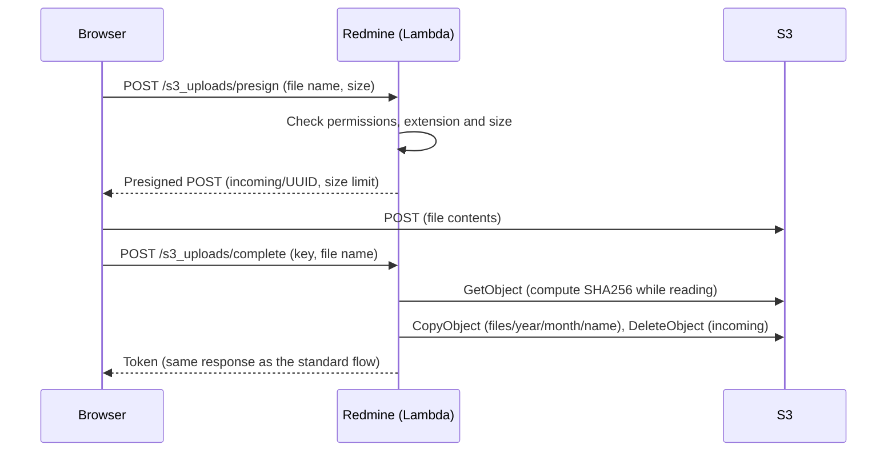
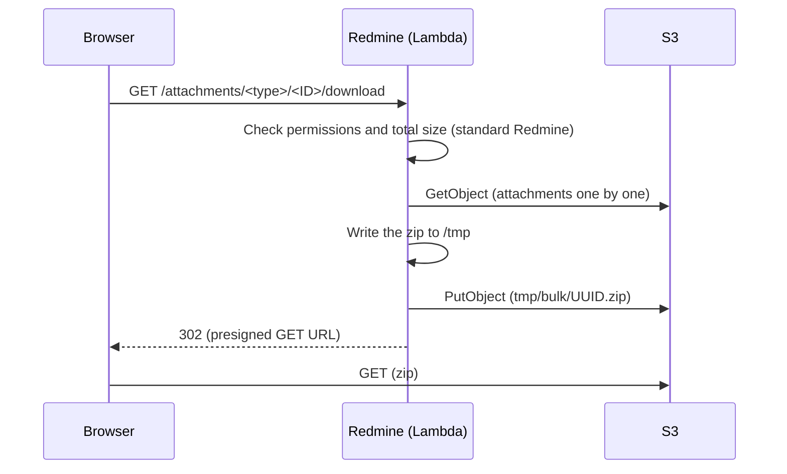

# Attachments and S3

This is the design for storing Redmine attachments in S3. Uploads go directly from the browser to S3. For downloads, Redmine checks permissions, then redirects to an S3 presigned URL. File contents do not pass through Lambda.

It is built as a feature of Redmine Serverless, following the approach of the Redmine S3 plugins below. No external plugins are installed.

The specifications in this document were checked against official information as of 2026-11-08 and the Redmine 7.0.3 source (d718d63 on 7.0-stable). Sources are in [sources.md](https://redmine-kit.github.io/serverless/sources.html).

## How Redmine stores attachments

Redmine stores attachments on the local disk. It does not use Active Storage (loading it is commented out in `config/application.rb`).

- **Saving:** `Attachment#files_to_final_location` (`app/models/attachment.rb` L146-175) writes the file to `files/<year>/<month>/`, computes the SHA256 while writing, and stores it in `digest`. The file name is `yymmddHHMMSS_original-name`.
- **What digest is used for:** The attachment token (`<id>.<digest>`), the ETag, thumbnail file names and sharing of files with the same content all depend on `digest`.
- **Code that uses the local path:** Thumbnails (ImageMagick, Ghostscript), previews of Office files (Pandoc), images in PDF exports, downloading all attachments (zip), and showing text and diffs read the path from `Attachment#diskfile`.
- **Upload flow:** As soon as a file is selected, the browser sends the raw bytes to `POST /uploads.js` (`uploadBlob` in `app/assets/javascripts/attachments.js`). Redmine creates an attachment record not attached to anything and returns a token. When an issue or similar object is saved, the record is attached by the token.
- **Download flow:** `AttachmentsController#download` checks permissions, then returns the file with `send_file`.

On Lambda, requests and responses are limited to 6 MB, so this flow cannot handle large files as is. Function URLs base64-encode binary data, so the actual file size that can be sent is about 4.5 MB (estimate). In addition, request bodies through CloudFront are limited to 1 MB ([lambda.md](https://redmine-kit.github.io/serverless/lambda.html#the-6-mb-limit)).

## The S3 plugin used as a reference

Redmine S3 plugins all follow the same idea: they read and write through the S3 API and redirect downloads to S3 URLs. The long-standing `redmine_s3` (ka8725) is in the same line.

| Plugin | Supported Redmine | Approach |
| --- | --- | --- |
| [hgyoon-w/redmine5_amazon_s3](https://github.com/hgyoon-w/redmine5_amazon_s3) (2025-12-17) | 5.0 and later | PutObject to S3 on save. Redirects downloads and thumbnails to S3 URLs. Stores thumbnails in S3. Reads text and diffs for display from S3 |
| [redmine_cloud_attachment_pro](https://www.redmine.org/plugins/redmine_cloud_attachment_pro) (2026-03-12) | 4.0 to 6.1 | PutObject to S3 on save. Each time `diskfile` is called, fetches the file from S3 into a temporary file and returns its path |

No plugin stating support for 7.0 was found in the range searched (GitHub, and a search for "s3" in Plugins on redmine.org).

### Differences from that plugin

| Item | Plugin | This design | Reason |
| --- | --- | --- | --- |
| Upload | Rails receives the file and sends it to S3 | The browser sends it directly to S3 | Lambda's 6 MB limit |
| digest | The hgyoon-w plugin replaces it with the save time | Stays SHA256 | Tokens, ETags, thumbnails and sharing of identical content depend on the digest |
| Code that uses the local path | Fetches from S3 on every `diskfile` call (cloud_attachment_pro) | Caches in `/tmp` and reuses | Fewer repeated fetches in the same environment. A file never changes once saved, so the cache never goes stale |
| CSV import | Not supported | Import files are also stored in S3 | An import spans several requests, which can reach different environments |

## Options considered

| Option | Decision |
| --- | --- |
| Read and write through the S3 API (the plugins' approach) | Used |
| Mount an S3 bucket on `files/` with S3 Files | Not used. With uploads and downloads going between the browser and S3, the only remaining benefit is server-side processing (thumbnails and so on). For that, it would bring synchronization between the file system and S3 (about 60 seconds from a write until it appears in S3) and extra charges (0.36 USD per GB of stored data per month) |
| Mount EFS | Not used. Does not meet the requirement of storing files in S3 |

## Bucket layout

There is one bucket (written as `redmine-files` in this document; this is the example for the instance name `redmine`, and the real name follows the rules in [deploy-config.md](https://redmine-kit.github.io/serverless/deploy-config.html#names-derived-from-the-instance-name)).

| Key | Contents | Deleted when |
| --- | --- | --- |
| `files/<year>/<month>/<file name>` | Attachments. Same form as Redmine's `disk_directory` and `disk_filename` | Redmine deletes the attachment |
| `thumbnails/<digest>_<size>_<width>.thumb` | Thumbnails. Named by the same rule as Redmine | The original attachment is deleted |
| `tmp/bulk/<UUID>.zip` | zip files for downloading all attachments | After 1 day, by lifecycle |
| `imports/<hex>` | CSV import files | The import finishes. Leftovers after 7 days, by lifecycle |
| `incoming/<UUID>` | Files sent by the browser (before registration) | On registration. Leftovers after 1 day, by lifecycle |

- **Versioning:** Enabled. Deleting a file creates a delete marker, and old versions are removed by lifecycle after 30 days. A file deleted by mistake can be restored within those 30 days.
- **Encryption:** SSE-S3 (the S3 default).
- **Not public:** S3 Block Public Access is on for the whole account. The bucket policy rejects requests not using TLS.
- **CORS:** `POST` from the Redmine domain is allowed for uploads.
- **No route restriction:** Browsers use presigned URLs from the internet. Limiting the execution role's permissions to requests from a specific route (such as a VPC endpoint) would also break presigned URLs, so permissions are not limited that way.

## Upload

All files are sent directly from the browser to S3.

1. **Get the signature:** Add `POST /s3_uploads/presign`. It is same-origin, so rails-ujs adds the CSRF token. The same permission as the standard upload (`authorize_global`) is checked. The extension is checked with `Attachment.valid_extension?`, and the size against Redmine's attachment limit (`attachment_max_size`). The presigned POST policy fixes the key (`incoming/<UUID>`) and the size range (`content-length-range`). It expires in 15 minutes.
2. **Send to S3:** The browser sends a multipart POST to S3. One upload can be up to 5 GB.
3. **Register:** Add `POST /s3_uploads/complete`. Redmine computes the SHA256 while reading the S3 object, and uses the size from S3. If an attachment with the same digest and size already exists, it shares that file and deletes the uploaded object (the same idea as Redmine's `reuse_existing_file_if_possible`). Otherwise it copies the object to `files/<year>/<month>/<file name>` and deletes the object in `incoming/`. Then it creates the attachment record with `disk_directory`, `disk_filename`, `digest` and `filesize` set. The file contents are not passed to Redmine, so `files_to_final_location` does nothing.
4. **Return the token:** The response uses the same template as the standard `POST /uploads.js` (`attachments/upload.js.erb`). On the browser side, the token goes into the form as in the standard flow.

- **Browser side:** Add JavaScript that replaces `uploadBlob` in `attachments.js`. The queue, progress display and token handling stay standard. The JavaScript is in the plugin's assets and is loaded through a Redmine view hook (`view_layouts_base_html_head`).
- **The digest is not left to the browser:** Redmine computes the SHA256 on the server. What the browser reports is not trusted.
- **File size limit:** At registration, Lambda reads the whole file from S3. The limit is the size that fits within the `redmine-web` timeout (60 seconds). How large that is will be decided by measurement.

### Uploads through Lambda

On the following routes, the file reaches Rails.

- `POST /uploads.json` in the REST API (up to 1 MB)
- Form submission from browsers without the File API (up to 1 MB)
- Attachments in received mail (`redmine-task` reads them from S3, so the CloudFront and function URL limits do not apply)

Request bodies through CloudFront are limited to 1 MB, which is what the Lambda@Edge function that adds the body hash can read ([lambda.md](https://redmine-kit.github.io/serverless/lambda.html#the-6-mb-limit)). To send large files through the API, use the upload to S3 with a presigned POST (the flow above; it also works with API keys and OAuth).

These files are written to the `/tmp` cache (below) by Redmine's standard `files_to_final_location`, then put to S3 with PutObject. If PutObject fails, an exception is raised and the record is not saved.

## Download

All downloads are redirects to S3 presigned URLs.

1. Redmine's standard checks (login, project permissions) are applied.
2. The download count is incremented (for versions and project files, as in standard Redmine).
3. A 302 redirect goes to a presigned GET URL (expires in 5 minutes). `response-content-disposition` and `response-content-type` set the same file name and display behavior as Redmine. Redmine uses `inline` only for PDFs and `attachment` for everything else (`AttachmentsController#disposition`).

- **Checking that the file exists:** Before a download, Redmine checks that the local file exists (`file_readable`, `Attachment#readable?`). This check is replaced with an S3 HeadObject.
- **Showing images:** Images in wiki pages and issue descriptions (`/attachments/download/<id>/<name>`) are shown through the same redirect. `` shows the image even with `attachment`. Lambda is invoked once per image, so a page with many images starts as many environments as there are concurrent requests (estimate; to be measured after it is built).
- **CSP:** Redmine adds a `sandbox` CSP when returning attachments. Responses from S3 do not have it. The files are served from the S3 domain, so they cannot touch cookies on the Redmine domain.
- **Signature expiry:** Signatures are made with the temporary credentials of the Lambda execution role. When these credentials expire, the URL becomes invalid even before its own expiry. The expiry is kept short at 5 minutes, so this is not expected to matter.

### Thumbnails

These stay standard Redmine. Thumbnail images are created on demand at Redmine's standard path (`/attachments/thumbnail/<id>/<width>`) (thumbnails are enabled by default in Redmine; `thumbnails_enabled`).

- **Creating:** On the first request to that path, the original file is fetched from S3 into the `/tmp` cache, the thumbnail is created with Redmine's standard `Redmine::Thumbnail.generate`, and it is put to `thumbnails/` with PutObject.
- **Returning:** Redirect to a presigned URL (expires in 5 minutes) for the thumbnail in S3.
- **Browser cache:** The redirect response has `Cache-Control: private, max-age=300`. Reopening the same page within 5 minutes does not invoke Lambda.
- **Concurrent requests:** A page with many thumbnails invokes Lambda that many times at once, adding environments. Requests beyond the reserved concurrency of `redmine-web` (10) are rejected. Measure on pages with many thumbnails and raise the reserved concurrency if needed. If that is still not enough, consider writing presigned URLs directly into the HTML (the S3 plugins' approach).

### Text, diffs and previews

- **Showing text and diffs:** Standard Redmine. `Attachment#diskfile` returns the path in the `/tmp` cache, so the standard view (`AttachmentsController#show`) works as is. The displayed size is up to `file_max_size_displayed` (default 512 KB).
- **Previews of Office files (Pandoc), images in PDF exports:** These need a local path, so they read from the `/tmp` cache.
- **Downloading all attachments (zip):** Created as a temporary file in S3, then redirected to a presigned URL (below).

### Downloading all attachments

Redmine returns all attachments of an issue or similar object as one zip (`AttachmentsController#download_all`). By default it builds the zip in memory (`Attachment.archive_attachments`) and returns it in the response, which hits Lambda's 6 MB response limit. Instead, the zip is created as a temporary file in S3, and the response redirects to a presigned URL.

1. **Check:** Redmine's standard checks (whether the attachments are visible, whether the total exceeds `bulk_download_max_size`) are applied as is.
2. **Create:** Write the zip to `/tmp` while reading the attachments from S3 one at a time. Unlike standard Redmine, not all files are read into memory.
3. **Store:** Put the zip at `tmp/bulk/<UUID>.zip` (multipart upload if it is large). Delete the zip in `/tmp`.
4. **Return:** A 302 redirect to a presigned GET URL (expires in 5 minutes). The file name is the same as Redmine's (`<type>-<ID>-attachments.zip`), set to `attachment` with `response-content-disposition`.

- **Limit:** `bulk_download_max_size` stays at Redmine's default (100 MB). Measure whether creating the zip fits within the `redmine-web` timeout (60 seconds), and lower the limit if it does not.
- **Deleting temporary files:** Objects under `tmp/` are deleted by lifecycle after 1 day.
- **Other exports:** Exports such as issue list CSV and PDF and wiki HTML are returned directly from Redmine. Issue exports are limited to 500 by default (`issues_export_limit`), and other exports are mostly text and compressed, so they are not expected to reach 6 MB ([lambda.md](https://redmine-kit.github.io/serverless/lambda.html#the-6-mb-limit)).
- **No rebuilding:** If a zip for the same set of attachments (a key made from the attachment IDs and digests) is still in `tmp/bulk/`, redirect to it without rebuilding.
- **Checking that files exist:** Redmine checks each attachment with `readable?`. In this design `readable?` is an S3 HeadObject, so one HeadObject is sent per attachment (estimate: slow with many attachments; to be measured when built).

## The /tmp cache

Redmine's `attachments_storage_path` is set to `/tmp/redmine/files`, and this is used as a cache of S3.

- **Path form:** `/tmp/redmine/files/<year>/<month>/<file name>`, the same form as the S3 key (`files/<year>/<month>/<file name>`). `Attachment#diskfile` can be used as in standard Redmine.
- **Fetching:** `Attachment#diskfile` is replaced so that it decides as follows before returning the path.
  - If the file exists locally, return that path. This also covers a save in progress (after `files_to_final_location` has created the file), and S3 is not fetched.
  - If the file is not local and the record is saved, fetch it from S3, then return the path. The file is written under another name and then renamed, so a partial file is never read.
  - Deletion (`delete_from_disk!`) and the existence check (`readable?`) are replaced so they do not go through `diskfile`. This avoids fetching a file only to delete it or check it.
- **Never stale:** Attachments never change once saved, so the cache does not need revalidation.
- **Size:** The function's `/tmp` is 2,048 MB, and the oldest files are deleted when the cache exceeds 1,536 MB. When the environment goes away, so does the cache.
- **CSV import:** Import files are also written to `/tmp/redmine/imports`, then put to `imports/` with PutObject, and fetched from S3 when read if they are not local. `Import#filepath` is fixed to `Rails.root/tmp/imports`, so `tmp` in the image is a symbolic link to `/tmp/redmine` ([lambda.md](https://redmine-kit.github.io/serverless/lambda.html#read-only-file-system)).
- **Cache for Office file previews:** Redmine stores it in `files/derived_cache/`. It lives inside the `/tmp` cache, not in S3, and is rebuilt per environment.

## Deletion

- **Attachments:** Redmine deletes a file only when no other attachment refers to the same file (`delete_from_disk`). This decision is kept, and the deleting code (`delete_from_disk!`) is replaced to delete `files/...` in S3 and the thumbnails starting with `thumbnails/<digest>_<size>_`. The `/tmp` cache is also cleared.
- **Sharing files with the same content:** Redmine's `reuse_existing_file_if_possible` compares local files. It is replaced to decide by whether the digest (SHA256) and size match, and the newer S3 object is deleted.
- **Attachments not attached to anything:** The task function runs `redmine:attachments:prune` daily. It deletes those older than 1 day through Redmine's deletion flow.

## Replaced code

Redmine's own files are not modified; Redmine Serverless replaces code with `prepend`. The added endpoints (`/s3_uploads/presign`, `/s3_uploads/complete`) are in the plugin's routes and controller.

| Target | Replacement | Reason |
| --- | --- | --- |
| `Attachment#files_to_final_location` | After the standard processing, PutObject to S3 | Uploads through Lambda |
| `Attachment#readable?` | S3 HeadObject | Check before download |
| Code that uses `Attachment#diskfile` | Fetch into the `/tmp` cache before use | Thumbnails, previews, PDF, zip |
| `Attachment#delete_from_disk!` | Delete from S3 | Deletion |
| `Attachment#reuse_existing_file_if_possible` | Compare by digest and size | Sharing identical content |
| `Attachment#thumbnail` | Use the one in S3 if it exists; otherwise create and store it | Thumbnails |
| `AttachmentsController#download`, `#thumbnail` | Redirect to a presigned URL (with `Cache-Control` for thumbnails) | Download, thumbnails |
| `AttachmentsController#download_all` | Write the zip to `/tmp`, store it as a temporary file in S3, and redirect to a presigned URL | Downloading all attachments |
| `Import#file=` and reading | Store in S3; fetch from S3 if not local | CSV import |
| `uploadBlob` in `attachments.js` | Send to S3 with a presigned POST | Upload |
| `Setting.enabled_scm`, `Setting.autofetch_changesets?`, `Setting.sys_api_enabled?`, `Setting.mail_handler_api_enabled?` | On Lambda, return fixed values (empty or disabled). Saving does not change them | Settings that cannot work on Lambda ([admin.md](admin.md#redmine-settings-that-cannot-work-on-lambda)) |

- **Enabling condition:** The replacements are enabled only when the S3 bucket is configured (environment variable). Without it, Redmine behaves as standard. This lets Redmine's own tests pass as is ([testing.md](https://redmine-kit.github.io/serverless/testing.html#redmines-own-tests)).
- **Redmine upgrades:** When upgrading Redmine, check that the original code of the replaced methods has not changed. This table is the authoritative list of replacements. If the original code changes, a test must fail ([testing.md](https://redmine-kit.github.io/serverless/testing.html#redmines-own-tests)).
- **Tests:** Each piece of replaced code gets tests written with Redmine's test framework ([testing.md](https://redmine-kit.github.io/serverless/testing.html#attachments-in-s3)).

## Permissions

The execution roles of `redmine-web`, `redmine-worker` and `redmine-task` get read and write permissions per prefix of the attachment bucket. Details are in [iam.md](https://redmine-kit.github.io/serverless/iam.html). Lambda is outside a VPC and reaches the public S3 endpoint. In the RDS setup, traffic goes from inside the VPC through an S3 gateway endpoint (free) ([rds.md](https://redmine-kit.github.io/serverless/rds.html#routes-out-of-the-vpc)).

## To verify

- The file size whose SHA256 computation at registration fits within 60 seconds
- Whether Japanese file names are saved correctly with a presigned GET (how to write `response-content-disposition`)
- Whether pasted images and drag and drop work as in standard Redmine after replacing `uploadBlob`
- CORS for the presigned POST, and how errors (such as exceeding the size) are shown
