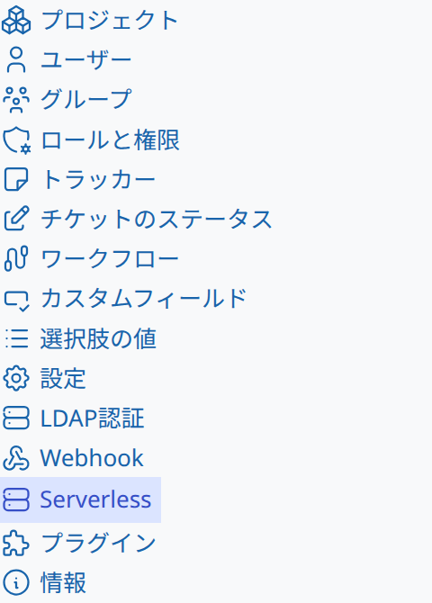
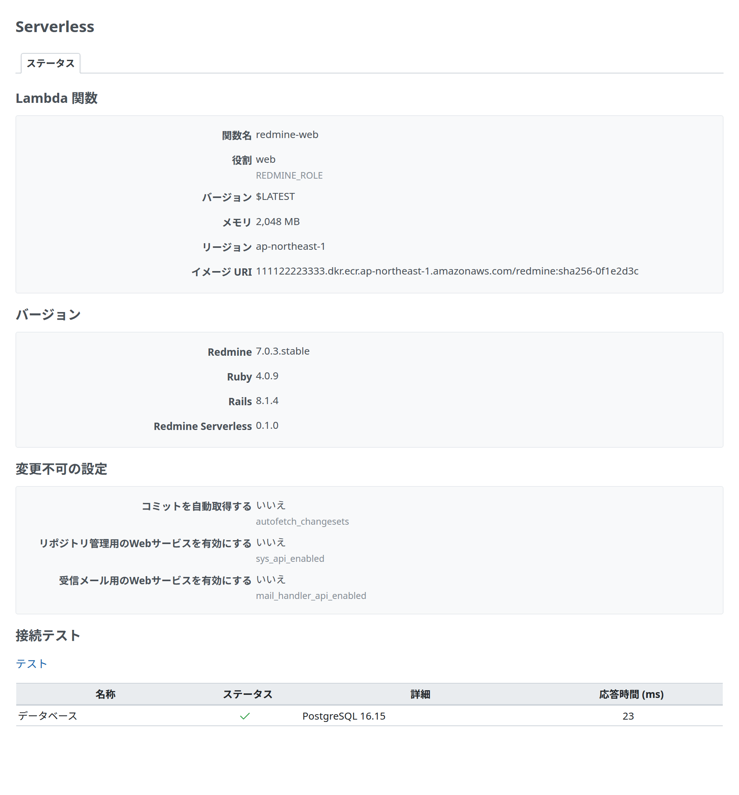
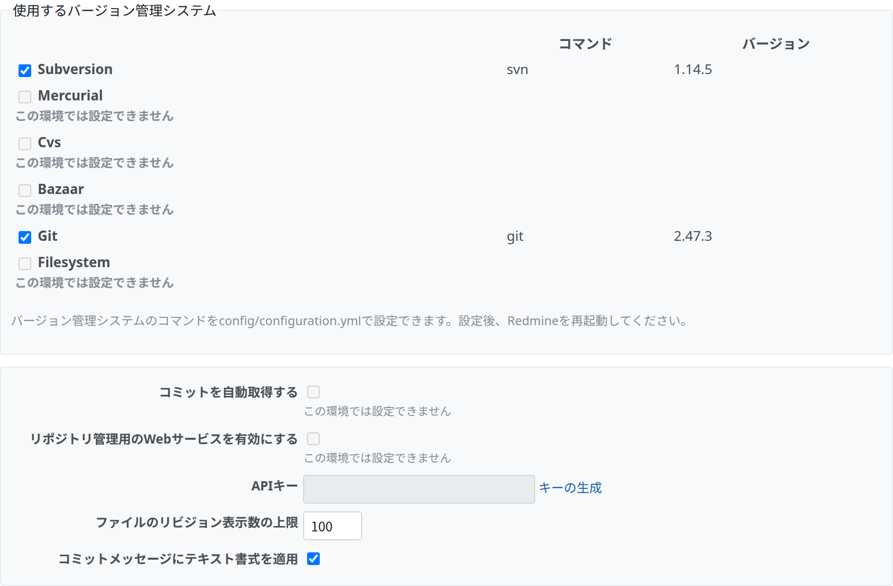

# 管理画面

すべての Redmine Serverless のプラグインが共有する、Redmine の管理のメニューの「Serverless」の項目と、そこに Redmine Serverless が置く画面です。使っていない機能の画面は出しません。AWS への接続の状態を、Redmine の画面で確認できるようにします。[Redmine Serverless S3](https://redmine-kit.github.io/redmine_serverless_s3/ja/admin.html)、[Redmine Serverless SES](https://redmine-kit.github.io/redmine_serverless_ses/ja/admin.html)、[Redmine Serverless SQS](https://redmine-kit.github.io/redmine_serverless_sqs/ja/admin.html) を入れると、それぞれの画面がここのタブに加わります。

この資料の仕様は、2026-11-08 時点の公式の情報と、Redmine 7.0.3 のソースで確認したものです。出典は [sources.md](https://redmine-kit.github.io/serverless/ja/sources.html) にあります。

## 方針

| 項目 | 内容 |
| --- | --- |
| 管理者だけ | どの画面も、Redmine の管理者だけが開けます。Redmine の管理の画面と同じ確認(`require_admin`)を使います |
| 秘密の値は出さない | SSM Parameter Store の値、`SECRET_KEY_BASE`、データベースのパスワードは、画面に出しません。パラメーターの名前と、読めたかどうかだけを出します |
| AWS の API は必要なときだけ呼ぶ | 画面を開いただけで多くの API を呼ばないよう、状態は 1 分だけキャッシュし、接続テストはボタンを押したときだけ行います(サービスごとに軽い呼び出しを 1 回、その要求の中で) |
| 秘密でない設定は画面で変える | 秘密でない設定は、プラグインの設定(Redmine の `Setting.plugin_*`、データベースに入る)にし、画面で変えられるようにします。AWS のリソースの名前など、インフラで決まる値は、環境変数のまま表示だけします |
| 操作は記録する | 画面での操作は、Redmine のログに、誰がいつ何をしたかを残します |

## 画面一覧

| 画面 | 追加するもの | 内容 |
| --- | --- | --- |
| ステータス | このプラグイン | 動いている関数とバージョン、データベースと AWS の各サービスに届くか、読み込んだ設定の名前、変更不可の Redmine の設定 |
| ジョブ | [Redmine Serverless SQS](https://redmine-kit.github.io/redmine_serverless_sqs/ja/admin.html) | そのプラグインを入れたときに加わる |
| メール送信、メール受信 | [Redmine Serverless SES](https://redmine-kit.github.io/redmine_serverless_ses/ja/admin.html) | そのプラグインを入れたときに加わる |
| S3 | [Redmine Serverless S3](https://redmine-kit.github.io/redmine_serverless_s3/ja/admin.html) | そのプラグインを入れたときに加わる |

## Serverless メニュー

Redmine Serverless のプラグインは、どれをインストールしていても、管理の画面を Redmine の管理のメニューの 1 つの項目「Serverless」の下に置きます。画面は、1 つのページのタブになります。

| 項目 | 内容 |
| --- | --- |
| 項目は 1 つ | 最初に読み込まれたプラグインが「Serverless」の項目と共有のページを追加し、ほかのプラグインはタブだけを追加します。プラグインは、Redmine の管理のメニューにまだその項目がないときだけ追加します(`Redmine::MenuManager.items(:admin_menu)`)。どのプラグインも、同じ 3 つのファイルを持ちます。登録先の `RedmineServerlessAdmin`(`lib/redmine_serverless_admin.rb`)、コントローラーの `ServerlessAdminController`、ビューの `serverless_admin/_tabs` です。Redmine のコードの読み込みとビューのパスは、最初に見つけたものを使い、ほかは使わないので、どのコピーも同じにしておきます(`SHARED_VERSION`)。各プラグインは、`init.rb` で、そこに自分のタブと接続テストを登録します(`register_tab`、`register_check`)。最初の登録が、メニューの項目を追加します。項目は `/admin/serverless` を開き、そこから最初のタブに移ります |
| タブの並び | ステータス、ジョブ、メール送信、メール受信、S3。タブは、そのプラグインをインストールしているときだけ出ます |
| このプラグインがないとき | 「ステータス」のタブは出ず、ほかのプラグインのタブは「Serverless」の下に出ます。たとえば、Redmine Serverless S3 だけをインストールした Redmine では、「Serverless」の項目に「S3」のタブが 1 つだけ出ます |
| プラグインの一覧から | プラグインは、Redmine のプラグインの設定の画面を持たないので、プラグインの一覧に「設定」のリンクは出ません。設定は、それぞれのタブにあります |
| プロジェクトの設定 | Redmine Serverless SES がプロジェクトの設定に追加する「メール」のタブは、このメニューには含めません |

## ステータス

| 項目 | 内容 | 取得元 |
| --- | --- | --- |
| Lambda 関数 | 関数名、役割(`REDMINE_ROLE`)、バージョン、メモリ、リージョン、イメージ URI | Lambda の環境変数(`AWS_LAMBDA_FUNCTION_NAME` など)と、ビルドのときにイメージに入れた値 |
| バージョン | Redmine、Ruby、Rails、入れている Redmine Serverless のプラグイン | Redmine の情報の画面と同じもの |
| Parameter Store | `/<instance>/env/` の下のパラメーターの名前と、読めたかどうか(値は出さない)。[Redmine Serverless SSM](https://redmine-kit.github.io/redmine_serverless_ssm/ja/) を入れたときに出す | 起動のときに読んだ結果(`RedmineServerlessSsm.loaded`) |
| 変更不可の設定 | 下の「Lambda で使えない Redmine の設定」のうち、無効に固定する設定と、今の値 (はい/いいえ) | プラグインが決めた値 |
| 接続テスト | データベースと、入れているプラグインの AWS のサービスに届くか、応答時間(ミリ秒) | 「テスト」を押したときに、軽い呼び出しを 1 回ずつ行う(下の表) |

| 確認する先 | 呼ぶ API |
| --- | --- |
| データベース | 設定した PostgreSQL のデータベース(RDS for PostgreSQL など)に新しい接続を作り、サーバーのバージョン(`SHOW server_version`)を読む。「PostgreSQL 16.4」のように、アダプターといっしょに出す |
| S3 | `HeadBucket`。Redmine Serverless S3 が追加する |
| SES | `GetAccount`。Redmine Serverless SES が追加する |
| SQS | `GetQueueAttributes`。Redmine Serverless SQS が追加する |
| SSM | `GetParametersByPath`(1 件だけ)。Redmine Serverless SSM が追加する |

それぞれの確認は、そのプラグインが IAM 権限のページに書いた権限を使います。このプラグイン自身の権限は要りません。

IAM の権限、ネットワークの設定、SSM の設定を変えたあとに、どこまで要求が届くかをこの確認で見られます。Lambda を VPC に入れたときは、VPC エンドポイントやセキュリティグループの設定の確認にも使えます。

## Lambda で使えない Redmine の設定

Redmine の標準の設定のうち、Lambda の上では動かないものや、この設計では開けておかないものは、プラグインが無効に固定し、Redmine の設定の画面にもそう表示します。

| 設定(Redmine の画面の名前) | 画面 | プラグインの扱い | 理由 |
| --- | --- | --- | --- |
| 使用するバージョン管理システム(`enabled_scm`) | 管理 › 設定 › リポジトリ | Subversion と Git だけを有効にでき、ほかは無効になる。プロジェクトには Subversion と Git のリポジトリを作成できる | Serverless のイメージには、Subversion と Git のクライアントだけがある。Subversion のリポジトリはリモート (`https://`、`svn://`) でもよく、Redmine はコピーを持たずに `svn` で読む。Git のリポジトリは、Redmine がローカルのベアリポジトリを `git` で読む。Lambda で書き込めるのは `/tmp` だけで、`/tmp` に置いたリポジトリは実行環境が停止すると失われる。Git のリポジトリの保存先は未決定 ([Serverless の lambda.md](https://redmine-kit.github.io/serverless/ja/lambda.html#repositories)) |
| コミットを自動取得する(`autofetch_changesets`) | 同上 | 無効に固定する | 有効にすると、Redmine はリポジトリの画面を表示するときに新しいコミットを取得するので、画面がクライアントの処理を待つ。大きなリポジトリの最初の取得は、web の関数のタイムアウト (60 秒) までに終わらないことがある。コミットは代わりに `redmine-task` の `rake redmine:fetch_changesets` で取得する ([Serverless の lambda.md](https://redmine-kit.github.io/serverless/ja/lambda.html#repositories)) |
| リポジトリ管理用のWebサービスを有効にする(`sys_api_enabled`) | 同上 | 無効に固定する | この Web サービスは、サーバーのディスクにリポジトリを作成する `reposman.rb` と、Redmine にコミットの取得を依頼するフックのためのもの。Lambda にはリポジトリを置くディスクがなく、取得は上のタスクで行うので、開けない |
| 受信メール用のWebサービスを有効にする(`mail_handler_api_enabled`) | 管理 › 設定 › 受信メール | 無効に固定する | メールは SES で受けて `redmine-task` が取り込む([mail.md](https://redmine-kit.github.io/serverless/ja/mail.html#receiving)、[Redmine Serverless SES](https://redmine-kit.github.io/redmine_serverless_ses/ja/))。外から HTTP でメールを送り込める Web サービスを開けない |

| 項目 | 内容 |
| --- | --- |
| 値を固定する | プラグインが、上の設定の読み出し(`Setting.enabled_scm`、`Setting.autofetch_changesets?`、`Setting.sys_api_enabled?`、`Setting.mail_handler_api_enabled?`)を差し替えて、決めた値を返します。`Setting.enabled_scm` は、保存した値から Subversion と Git 以外を除いて返します。プラグインが Redmine の処理を差し替えるのはここだけです。Redmine のバージョンアップでは、これらの読み出しが変わっていないかを確認します。設定の画面から保存しても、これらの値は変わりません。データベースに古い値が残っていても、使われません。Subversion と Git の選択だけは、保存した値を使います |
| 画面に表示する | Redmine の設定の画面で、上の設定の入力を押せなくし、「この環境では設定できません」と添えます。画面のテンプレートは差し替えず、設定の画面を開いたときだけ、プラグインが小さな JavaScript を読み込んで表示を変えます(Redmine の標準のフック `view_layouts_base_html_head`)。JavaScript が動かなくても、値は上のとおり固定されているので、効き目は変わりません |
| 条件 | Lambda の上(`REDMINE_ROLE` があるとき)だけ固定します。手元のテストや、Lambda 以外の環境では、Redmine の標準のままです |
| 管理画面の「情報」 | Redmine の標準の確認(ファイルの保存先に書き込めるか、ジョブのキューをデフォルトから変えたか、ImageMagick、Ghostscript、Pandoc など)は、Serverless で通る見込みです(保存先は `/tmp/redmine/files`、ジョブは `:sqs`) |

## 権限

画面は、このプラグイン自身の AWS の API を呼びません。[iam.md](iam.md) を見てください。

## テスト

画面ごとに、Redmine の機能のテストがあります([testing.md](https://redmine-kit.github.io/serverless/ja/testing.html#administration-pages))。

このページの画面のスクリーンショットは、`bin/screenshots` で撮ります(Docker の中のヘッドレスの Chromium と、Redmine のテストのデータ)。画面を変えたら実行します。
