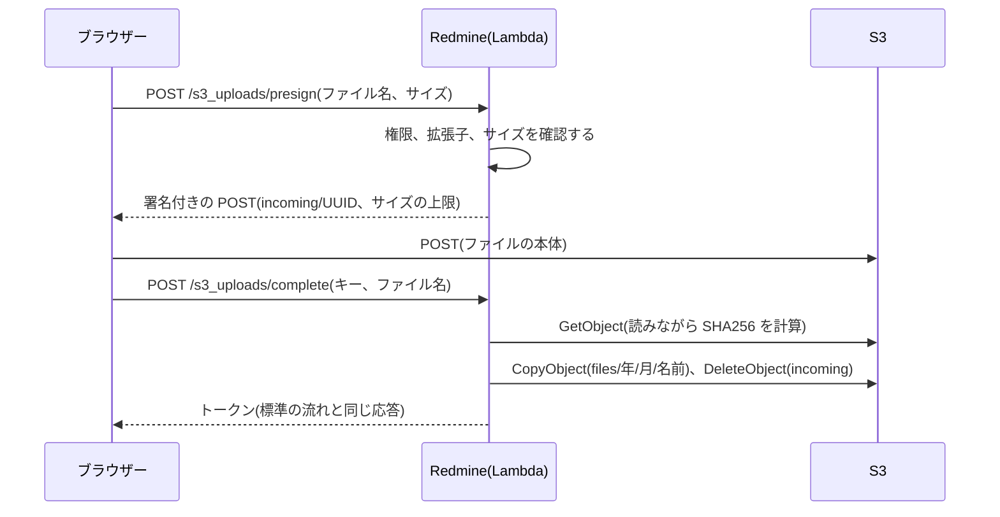
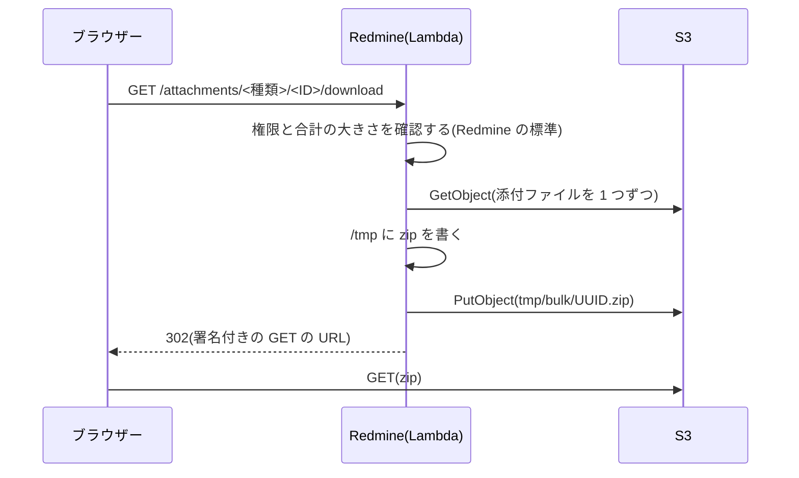

# 添付ファイルと S3

Redmine の添付ファイルを S3 に置く設計です。アップロードは、ブラウザーから S3 に直接送ります。ダウンロードは、Redmine が権限を確認してから、S3 の署名付き URL にリダイレクトします。ファイルの本体は Lambda を通りません。

Redmine の S3 のプラグイン(下記)のやり方を参考に、Redmine Serverless の機能として作ります。外部のプラグインは入れません。

この資料の仕様は、2026-11-08 時点の公式の情報と、Redmine 7.0.3 のソース(7.0-stable の d718d63)で確認したものです。出典は [sources.md](https://redmine-kit.github.io/redmine-serverless/ja/sources.html) にあります。

## Redmine の添付ファイルの仕組み

Redmine は、添付ファイルをローカルのディスクに保存します。Active Storage は使っていません(`config/application.rb` で読み込みがコメントアウトされている)。

- **保存:** `Attachment#files_to_final_location`(`app/models/attachment.rb` L146-175)が、`files/<年>/<月>/` にファイルを書き、書きながら SHA256 を計算して `digest` に入れます。ファイル名は `yymmddHHMMSS_元の名前` です。
- **digest の使い道:** 添付のトークン(`<id>.<digest>`)、ETag、サムネイルのファイル名、同じ内容のファイルの共有が、すべて `digest` に頼っています。
- **ローカルのパスを使う処理:** サムネイル(ImageMagick、Ghostscript)、Office のファイルのプレビュー(Pandoc)、PDF の出力の画像、添付の一括のダウンロード(zip)、テキストと差分の表示が、`Attachment#diskfile` のパスを読みます。
- **アップロードの流れ:** ブラウザーは、ファイルを選ぶとすぐに `POST /uploads.js` に生のバイト列を送ります(`app/assets/javascripts/attachments.js` の `uploadBlob`)。Redmine は、どこにも付いていない添付のレコードを作って、トークンを返します。チケットなどを保存するときに、トークンでレコードを付けます。
- **ダウンロードの流れ:** `AttachmentsController#download` が、権限を確認してから `send_file` でファイルを返します。

Lambda では、要求と応答が 6 MB までなので、この流れのままでは大きなファイルを扱えません。関数 URL はバイナリを base64 にするので、実際に送れるファイルは約 4.5 MB です(推測)。さらに、CloudFront を通る要求の本文は 1 MB までです([lambda.md](https://redmine-kit.github.io/redmine-serverless/ja/lambda.html#the-6-mb-limit))。

## 参考にした S3 のプラグイン

Redmine の S3 のプラグインは、どれも同じ考え方です。S3 の API で読み書きし、ダウンロードを S3 の URL にリダイレクトします。古くからある `redmine_s3`(ka8725)も、この系統です。

| プラグイン | 対応する Redmine | やり方 |
| --- | --- | --- |
| [hgyoon-w/redmine5_amazon_s3](https://github.com/hgyoon-w/redmine5_amazon_s3)(2025-12-17) | 5.0 以上 | 保存のときに S3 に PutObject。ダウンロードとサムネイルを S3 の URL にリダイレクト。サムネイルを S3 に置く。表示のテキストと差分は S3 から読む |
| [redmine_cloud_attachment_pro](https://www.redmine.org/plugins/redmine_cloud_attachment_pro)(2026-03-12) | 4.0〜6.1 | 保存のときに S3 に PutObject。`diskfile` が呼ばれるたびに、S3 から一時ファイルに取ってパスを返す |

7.0 に対応すると書いたものは、探した範囲(GitHub と redmine.org の Plugins の「s3」の検索)では見つかりませんでした。

### プラグインと変えるところ

| 項目 | プラグイン | この設計 | 理由 |
| --- | --- | --- | --- |
| アップロード | Rails が受けて S3 に送る | ブラウザーから S3 に直接送る | Lambda の 6 MB の制限 |
| digest | hgyoon-w のものは、保存の時刻に置き換える | SHA256 のまま | トークン、ETag、サムネイル、同じ内容の共有が digest に頼っている |
| ローカルのパスを使う処理 | `diskfile` のたびに S3 から取る(cloud_attachment_pro) | `/tmp` にキャッシュして使い回す | 同じ環境での取り直しを減らす。ファイルは一度保存したら変わらないので、キャッシュが古くならない |
| CSV のインポート | 対応していない | インポートのファイルも S3 に置く | インポートは複数の要求にまたがり、別の環境に届くことがある |

## 検討した方法

| 方法 | 判断 |
| --- | --- |
| S3 の API で読み書きする(プラグインのやり方) | 使う |
| S3 Files で S3 のバケットを `files/` にマウントする | 使わない。アップロードとダウンロードをブラウザーと S3 のあいだで行うと、残る利点はサーバーでの処理(サムネイルなど)だけになる。そのために、ファイルシステムと S3 のあいだの同期(書き込みから S3 に出るまで 60 秒ほど)と、追加の料金(載っているデータ 1 GB あたり月 0.36 ドル)を抱えることになる |
| EFS をマウントする | 使わない。S3 に置くという要件に合わない |

## バケットの構成

バケットは 1 つです(この資料では `redmine-files` と書きます。インスタンスの名前が `redmine` のときの例で、本当の名前は [deploy-config.md](https://redmine-kit.github.io/redmine-serverless/ja/deploy-config.html#names-derived-from-the-instance-name) の決まりで作ります)。

| キー | 中身 | 消すとき |
| --- | --- | --- |
| `files/<年>/<月>/<ファイル名>` | 添付ファイル。Redmine の `disk_directory` と `disk_filename` と同じ形 | Redmine が添付を消したとき |
| `thumbnails/<digest>_<サイズ>_<幅>.thumb` | サムネイル。名前は Redmine と同じ規則 | 元の添付を消したとき |
| `tmp/bulk/<UUID>.zip` | 添付の一括のダウンロードの zip | ライフサイクルで 1 日 |
| `imports/<16 進>` | CSV のインポートのファイル | インポートが終わったとき。残ったものはライフサイクルで 7 日 |
| `incoming/<UUID>` | ブラウザーが送ったファイル(登録の前) | 登録したとき。残ったものはライフサイクルで 1 日 |

- **バージョニング:** 有効にします。ファイルを消すと削除マーカーになり、古いバージョンはライフサイクルで 30 日後に消します。誤って消したファイルを、30 日のあいだは戻せます。
- **暗号化:** SSE-S3(S3 の既定)にします。
- **公開しない:** アカウント全体で S3 のパブリックアクセスをブロックしています。バケットポリシーで、TLS でない要求を断ります。
- **CORS:** アップロードのために、Redmine のドメインからの `POST` を許可します。
- **経路の制限はしない:** 署名付き URL は、ブラウザーがインターネットから使います。実行ロールの権限を特定の経路(VPC エンドポイントなど)からの要求に限ると、署名付き URL も使えなくなるので、限りません。

## アップロード

すべてのファイルを、ブラウザーから S3 に直接送ります。

1. **署名を受け取る:** `POST /s3_uploads/presign` を足します。同一オリジンなので、rails-ujs が CSRF のトークンを付けます。権限は、標準のアップロードと同じもの(`authorize_global`)を確認します。拡張子は `Attachment.valid_extension?` で、サイズは Redmine の添付の上限(`attachment_max_size`)で確認します。署名付きの POST のポリシーで、キー(`incoming/<UUID>`)とサイズの範囲(`content-length-range`)を固定します。期限は 15 分です。
2. **S3 に送る:** ブラウザーが S3 に multipart の POST を送ります。1 回の送信は 5 GB までです。
3. **登録する:** `POST /s3_uploads/complete` を足します。Redmine が S3 のオブジェクトを読みながら SHA256 を計算し、サイズは S3 の値を使います。同じ digest とサイズの添付がすでにあれば、そのファイルを共有し、送られたオブジェクトは消します(Redmine の `reuse_existing_file_if_possible` と同じ考え方)。なければ `files/<年>/<月>/<ファイル名>` にコピーし、`incoming/` のオブジェクトを消します。そのうえで、添付のレコードを `disk_directory`、`disk_filename`、`digest`、`filesize` を指定して作ります。ファイルの本体を Redmine に渡さないので、`files_to_final_location` は何もしません。
4. **トークンを返す:** 応答は、標準の `POST /uploads.js` と同じテンプレート(`attachments/upload.js.erb`)で返します。ブラウザーの側は、標準の流れと同じくトークンをフォームに入れます。

- **ブラウザーの側:** `attachments.js` の `uploadBlob` を差し替える JavaScript を足します。キュー、進み具合の表示、トークンの扱いは標準のままです。JavaScript は、プラグインのアセットに置き、Redmine のビューのフック(`view_layouts_base_html_head`)で読み込みます。
- **digest をブラウザーに任せない:** SHA256 は、Redmine がサーバーで計算します。ブラウザーの申告は信用しません。
- **ファイルの大きさの上限:** 登録のときに、Lambda が S3 からファイル全体を読みます。`redmine-web` のタイムアウト(60 秒)に収まる大きさが上限になります。どこまで収まるかは測って決めます。

### Lambda を通るアップロード

次の経路は、ファイルが Rails に届きます。

- REST API の `POST /uploads.json`(1 MB まで)
- File API のないブラウザーのフォームの送信(1 MB まで)
- メールで受けた添付ファイル(S3 から `redmine-task` が読むので、CloudFront と関数 URL の制限は当たらない)

CloudFront を通る要求の本文は、本文のハッシュを入れる Lambda@Edge が読める 1 MB までです([lambda.md](https://redmine-kit.github.io/redmine-serverless/ja/lambda.html#the-6-mb-limit))。大きなファイルを API で送るときは、署名付きの POST での S3 へのアップロード(上の流れ。API キーと OAuth でも使える)を使います。

これらは、Redmine の標準の `files_to_final_location` で `/tmp` のキャッシュ(下記)に書いたあと、S3 に PutObject します。PutObject が失敗したら、例外にしてレコードを保存しません。

## ダウンロード

すべてのダウンロードを、S3 の署名付き URL へのリダイレクトにします。

1. Redmine の標準の確認(ログイン、プロジェクトの権限)を通します。
2. ダウンロードの回数を数えます(バージョンとプロジェクトのファイル。Redmine の標準と同じ)。
3. 署名付きの GET の URL(期限 5 分)に 302 でリダイレクトします。`response-content-disposition` と `response-content-type` で、Redmine と同じファイル名と表示のしかたを指定します。Redmine は、PDF だけを `inline`、ほかを `attachment` にします(`AttachmentsController#disposition`)。

- **ファイルがあるかの確認:** Redmine は、ダウンロードの前にローカルのファイルがあるかを確認します(`file_readable`、`Attachment#readable?`)。この確認は、S3 の HeadObject に替えます。
- **画像の表示:** wiki やチケットの本文の画像(`/attachments/download/<id>/<名前>`)も、同じリダイレクトで表示されます。`` は、`attachment` の指定があっても画像を表示します。画像の数だけ Lambda が呼ばれるので、画像の多いページでは、同時の要求の数だけ環境が起動します(推測。作ったあとで測る)。
- **CSP:** Redmine は、添付を返すときに `sandbox` の CSP を付けます。S3 からの応答にはこれが付きません。ファイルは S3 のドメインから返るので、Redmine のドメインの Cookie には触れられません。
- **署名の期限:** 署名は Lambda の実行ロールの一時的な認証情報で作ります。この認証情報が切れると、URL の期限の前でも無効になります。期限を 5 分と短くするので、影響はないと見ています。

### サムネイル

Redmine の標準のままにします。サムネイルの画像は、Redmine の標準のパス(`/attachments/thumbnail/<id>/<幅>`)で、必要になったときに作ります(Redmine の既定でサムネイルは有効。`thumbnails_enabled`)。

- **作る:** そのパスに初めて届いたときに、S3 から元のファイルを `/tmp` のキャッシュに取り、Redmine の標準の `Redmine::Thumbnail.generate` で作って、`thumbnails/` に PutObject します。
- **返す:** S3 にあるサムネイルの、署名付き URL(期限 5 分)にリダイレクトします。
- **ブラウザーのキャッシュ:** リダイレクトの応答に `Cache-Control: private, max-age=300` を付けます。同じ画面を 5 分のうちに開き直しても、Lambda を呼びません。
- **同時の要求:** 1 つの画面に多くのサムネイルがあると、その数だけ同時に Lambda が呼ばれ、環境が増えます。`redmine-web` の同時実行数の予約(10)を超えると、超えた分は断られます。サムネイルの多い画面で測り、足りなければ同時実行数の予約を増やします。それでも足りないときは、HTML に署名付き URL を直接書く形(S3 のプラグインのやり方)を考えます。

### テキスト、差分、プレビュー

- **テキストと差分の表示:** Redmine の標準のままです。`Attachment#diskfile` が `/tmp` のキャッシュのパスを返すので、標準の表示(`AttachmentsController#show`)がそのまま動きます。表示する大きさは `file_max_size_displayed`(既定 512 KB)までです。
- **Office のファイルのプレビュー(Pandoc)、PDF の出力の画像:** ローカルのパスが要るので、`/tmp` のキャッシュから読みます。
- **添付の一括のダウンロード(zip):** S3 に仮のファイルとして作り、署名付き URL にリダイレクトします(下記)。

### 添付の一括のダウンロード

Redmine は、チケットなどの添付ファイルをまとめて zip で返します(`AttachmentsController#download_all`)。標準では、zip をメモリで作り(`Attachment.archive_attachments`)、そのまま応答で返すので、Lambda の応答の 6 MB の制限に当たります。そこで、zip を S3 の仮のファイルとして作り、署名付き URL にリダイレクトします。

1. **確認する:** Redmine の標準の確認(添付ファイルが見えるか、合計が `bulk_download_max_size` を超えないか)を、そのまま通します。
2. **作る:** 添付ファイルを S3 から 1 つずつ読みながら、`/tmp` に zip を書きます。Redmine の標準のように、すべてのファイルをメモリに読みません。
3. **置く:** zip を `tmp/bulk/<UUID>.zip` に置きます(大きければマルチパートのアップロード)。`/tmp` の zip は消します。
4. **返す:** 署名付きの GET の URL(期限 5 分)に 302 でリダイレクトします。ファイル名は Redmine と同じ(`<種類>-<ID>-attachments.zip`)にし、`response-content-disposition` で `attachment` にします。

- **上限:** `bulk_download_max_size` は、Redmine の既定(100 MB)のままにします。zip を作る時間が、`redmine-web` のタイムアウト(60 秒)に収まるかを測り、収まらなければ下げます。
- **仮のファイルを消す:** `tmp/` の下は、ライフサイクルで 1 日後に消します。
- **ほかの出力:** チケットの一覧の CSV や PDF、wiki の HTML などの出力は、Redmine から、そのまま返します。チケットの出力は既定で 500 件まで(`issues_export_limit`)で、ほかの出力も文字が中心で圧縮されるので、6 MB に届かない見込みです([lambda.md](https://redmine-kit.github.io/redmine-serverless/ja/lambda.html#the-6-mb-limit))。
- **作り直さない:** 同じ添付ファイルの組み合わせ(添付ファイルの ID と digest から作るキー)の zip が、まだ `tmp/bulk/` にあれば、作り直さずにリダイレクトします。
- **ファイルがあるかの確認:** Redmine は、添付ファイルごとに `readable?` で確認します。この設計では `readable?` が S3 の HeadObject なので、添付ファイルの数だけ HeadObject を送ります(推測。数が多いと遅くなる。作るときに測る)。

## /tmp のキャッシュ

Redmine の `attachments_storage_path` を `/tmp/redmine/files` にし、ここを S3 のキャッシュとして使います。

- **パスの形:** `/tmp/redmine/files/<年>/<月>/<ファイル名>` で、S3 のキー(`files/<年>/<月>/<ファイル名>`)と同じ形です。`Attachment#diskfile` は、Redmine の標準のまま使えます。
- **取り方:** `Attachment#diskfile` を差し替え、パスを返す前に次のように判断します。
  - ローカルにファイルがあれば、そのパスを返します。保存の途中(`files_to_final_location` がファイルを作ったあと)もこれに当たり、S3 には取りに行きません。
  - ローカルになく、レコードが保存済みなら、S3 から取ってからパスを返します。別の名前で書いてから名前を変えるので、途中のファイルを読むことはありません。
  - 削除(`delete_from_disk!`)と、ファイルがあるかの確認(`readable?`)は、`diskfile` を通さないように差し替えます。消すだけのファイルや、確認するだけのファイルを取りに行かないためです。
- **古くならない:** 添付ファイルは一度保存したら変わらないので、キャッシュを確認直す必要はありません。
- **大きさ:** 関数の `/tmp` を 2,048 MB にし、1,536 MB を超えたら古いものから消します。環境が消えると、キャッシュも消えます。
- **CSV のインポート:** インポートのファイルも、`/tmp/redmine/imports` に書いたあと `imports/` に PutObject し、読むときにローカルになければ S3 から取ります。`Import#filepath` は `Rails.root/tmp/imports` に固定されているので、イメージの `tmp` を `/tmp/redmine` へのシンボリックリンクにします([lambda.md](https://redmine-kit.github.io/redmine-serverless/ja/lambda.html#read-only-file-system))。
- **Office のファイルのプレビューのキャッシュ:** Redmine は `files/derived_cache/` に置きます。`/tmp` のキャッシュの中に置き、S3 には置きません。環境ごとに作り直します。

## 削除

- **添付ファイル:** Redmine は、同じファイルを参照するほかの添付がないときだけ、ファイルを消します(`delete_from_disk`)。この判断はそのまま使い、消す処理(`delete_from_disk!`)を差し替えて、S3 の `files/...` と、`thumbnails/<digest>_<サイズ>_` で始まるサムネイルを消します。`/tmp` のキャッシュも消します。
- **同じ内容のファイルの共有:** Redmine の `reuse_existing_file_if_possible` は、ローカルのファイルを比べます。digest(SHA256)とサイズが同じかで判断するように差し替え、新しい方の S3 のオブジェクトを消します。
- **どこにも付いていない添付:** 毎日、タスク用の関数で `redmine:attachments:prune` を実行します。1 日以上たったものを、Redmine の削除の流れで消します。

## 差し替える処理

Redmine 本体のファイルは書き換えず、Redmine Serverless から `prepend` で差し替えます。足す画面(`/s3_uploads/presign`、`/s3_uploads/complete`)は、プラグインのルートとコントローラーに置きます。

| 対象 | 差し替え | 理由 |
| --- | --- | --- |
| `Attachment#files_to_final_location` | 標準の処理のあと、S3 に PutObject する | Lambda を通るアップロード |
| `Attachment#readable?` | S3 の HeadObject | ダウンロードの前の確認 |
| `Attachment#diskfile` を使う処理 | 使う前に `/tmp` のキャッシュに取る | サムネイル、プレビュー、PDF、zip |
| `Attachment#delete_from_disk!` | S3 から消す | 削除 |
| `Attachment#reuse_existing_file_if_possible` | digest とサイズで比べる | 同じ内容の共有 |
| `Attachment#thumbnail` | S3 にあればそれを使い、なければ作って置く | サムネイル |
| `AttachmentsController#download`、`#thumbnail` | 署名付き URL にリダイレクト(サムネイルは `Cache-Control` を付ける) | ダウンロード、サムネイル |
| `AttachmentsController#download_all` | zip を `/tmp` に書いて S3 の仮のファイルに置き、署名付き URL にリダイレクトする | 添付の一括のダウンロード |
| `Import#file=` と読み込み | S3 に置き、なければ S3 から取る | CSV のインポート |
| `attachments.js` の `uploadBlob` | 署名付きの POST で S3 に送る | アップロード |
| `Setting.enabled_scm`、`Setting.autofetch_changesets?`、`Setting.sys_api_enabled?`、`Setting.mail_handler_api_enabled?` | Lambda の上では、決めた値(空か無効)を返す。保存しても変えない | Lambda で使えない設定([admin.md](admin.md#redmine-settings-that-cannot-work-on-lambda)) |

- **有効にする条件:** S3 のバケットの設定(環境変数)があるときだけ、差し替えを有効にします。設定がなければ、Redmine の標準のままに動きます。Redmine 本体のテストを、そのまま通せるようにするためです([testing.md](https://redmine-kit.github.io/redmine-serverless/ja/testing.html#redmines-own-tests))。
- **Redmine の更新:** Redmine のバージョンを上げるときは、差し替えた処理の元のコードが変わっていないかを確認します。差し替えの一覧は、この表を正とします。元のコードが変わったら、テストが失敗するようにします([testing.md](https://redmine-kit.github.io/redmine-serverless/ja/testing.html#redmines-own-tests))。
- **テスト:** 差し替えた処理ごとに、Redmine のテストの仕組みでテストを書きます([testing.md](https://redmine-kit.github.io/redmine-serverless/ja/testing.html#attachments-in-s3))。

## 権限

`redmine-web`、`redmine-worker`、`redmine-task` の実行ロールに、添付ファイルのバケットのプレフィックスごとの読み書きを付けます。詳しくは [iam.md](https://redmine-kit.github.io/redmine-serverless/ja/iam.html) にあります。Lambda は VPC の外にあり、S3 の公開のエンドポイントに届きます。RDS の形では、VPC の中から S3 のゲートウェイエンドポイント(無料)を通ります([rds.md](https://redmine-kit.github.io/redmine-serverless/ja/rds.html#routes-out-of-the-vpc))。

## 確認すること

- 登録のときの SHA256 の計算で、60 秒に収まるファイルの大きさ
- 署名付きの GET で、日本語のファイル名が正しく保存されるか(`response-content-disposition` の書き方)
- `uploadBlob` を差し替えたときに、貼り付けた画像とドラッグ・アンド・ドロップが標準と同じに動くか
- 署名付きの POST の CORS と、エラー(サイズの超過など)の表示
